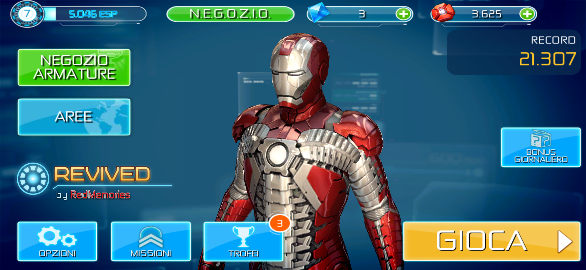
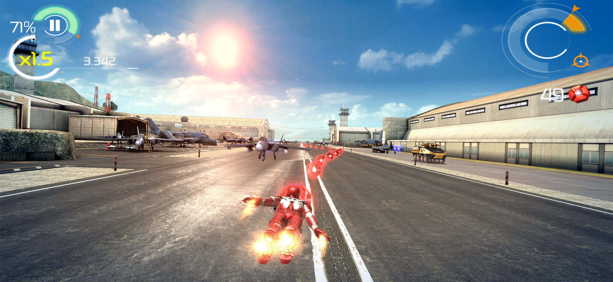
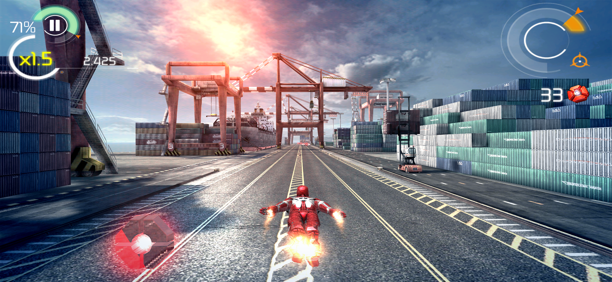
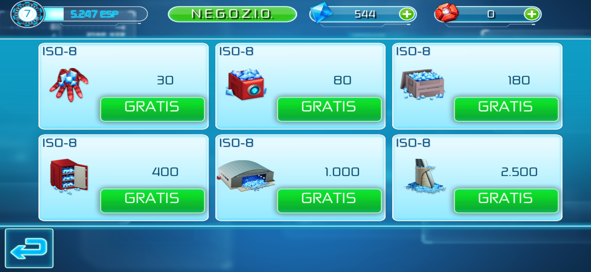

# Iron Man 3 Revived

> Iron Man is a trademark of Marvel. The Iron Man 3 mobile game is by Gameloft. This is a non-commercial fan project, not affiliated with Marvel, Disney or Gameloft. The game was pulled from the stores years ago. This repo is my private archive, please don't share the release files.

## What I did

I didn't remake the game and I didn't touch the gameplay. The runs, the suits, the bosses and the missions are exactly the ones from 2013.

As with The Amazing Spider-Man 2 and The Dark Knight Rises, I recompiled the whole engine to 64-bit code ahead of time: 37,125 of its 37,130 functions, rebuilt for today's phones. While you play, every call in the engine runs in the recompiled code, so the game runs as a modern app.

Once it was running, I gave it the treatment it deserves on a modern phone:

- full screen on today's tall displays, edge to edge, at the full resolution of the screen
- 4x anti-aliasing, so Iron Man and the scenery have clean edges instead of jagged ones
- the highest graphics profile: the game didn't recognize modern GPUs and turned off every effect, now you get bloom, sun rays, color grading, heat distortion and the detailed suit shaders
- sharper textures on roads and buildings seen at an angle
- 60 fps instead of the original 30, with the game speed and the slow motion still right
- clean sound from the first second: the menu music used to crackle for a few seconds after every launch

The game is now fully offline, with no ads and no tracking, and it doesn't ask for any permission. The buttons that sent you to services that don't exist anymore (friends and leaderboards, Facebook and Google+ sharing, Google Play Games, support pages, bonus codes, video ads) are gone. The old downloader and the Google Play license check, which can't work anymore, are gone too: the game data is packed inside the APK, so there's nothing to download separately.

The real-money store still opens, but every ISO-8 pack is free: tap it and the crystals are yours. If you'd rather earn them, just play: rewards and prices in the game are the same as before.

When I publish a new version, a small notice appears on the main menu, and tapping it opens the release page. That check is the only thing the app does online, and only once a day.

The game is controlled by tilting the phone and tapping the screen, like the original. There's no controller support.

## Install

1. Download the APK from **Releases**
2. Install it
3. Open it. The first launch takes a few seconds to unpack the game, after that it starts right away

No PC, no extra downloads, no account.

## Requirements

- 64-bit Android phone with Android 10 or newer
- about 3 GB of free space

I play it on a Galaxy S26 Ultra with Android 17. I haven't tried it on phones without a Snapdragon chip yet (MediaTek Dimensity, Exynos, Google Tensor): there the anti-aliasing is turned off to be safe. If you play on one of them, let me know how it runs.

## Credits

Revived by **RedMemories**

Thanks to the [dynarmic](https://github.com/azahar-emu/dynarmic) project: its ARM decoder is the base of the recompiler, and it still runs the few bits of the engine that aren't recompiled.

Original game by Gameloft.

## ☕ Support my work

If you enjoy my projects and would like to support my work, you can buy me a coffee on Ko-fi! Every project I create is and will always remain free, but any support is greatly appreciated and helps me keep working on new projects and improvements.

Thank you for your support! ❤️

[ko-fi.com/redmemories_ita](https://ko-fi.com/redmemories_ita)
